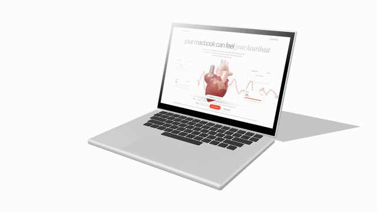

# macbook heartbeat

Every Apple Silicon MacBook has a motion sensor inside it. Apple doesn't document it
and there's no public API for it, but you can read it. I wanted to know if it's
sensitive enough to feel your pulse when you rest your wrists on the laptop.

Short answer: sometimes, barely. This repo is the experiment. It includes a small Swift
program that reads the sensor and a web page that draws what it sees.

**Live page:** https://macbook-heartbeat-rishabh.vercel.app (it needs the helper running on your Mac, see below)

<video src="https://github.com/rishabhknowss/ballistocardiography-Macbook-sensor-based-heartbeat/raw/main/docs/demo.mp4" controls width="100%"></video>

[](docs/demo.mp4)

<sub>30-second demo with sound: [1080p MP4](docs/demo.mp4) · [4K MP4](docs/demo-4k.mp4). Made with [HyperFrames](https://hyperframes.heygen.com), source in [`video/`](video). The voiceover and music are from HeyGen and the hand models are the MIT-licensed WebXR generic hands. The red trace is a real recording from the flat-table test below. The 3D heart is an illustration.</sub>

> This is a toy. It is not a medical device and the BPM number is not a real
> heart-rate measurement. Most of what you see on the waveform is your desk, your
> breathing and your hands, not your heart.

## Try it

You need an Apple Silicon MacBook (I tested on an M4 Air running macOS 27) and the
Xcode command line tools.

```sh
git clone https://github.com/rishabhknowss/macbook-heartbeat
cd macbook-heartbeat
make run
```

That builds `bin/heartbeat`, starts it, and opens `http://localhost:8787`. You don't
need sudo.

Then:

1. Put the laptop on a solid table, not your lap.
2. Rest both wrists flat on the palm rest, one each side of the trackpad. Don't press.
3. Stop typing, relax your hands, and breathe slowly or hold your breath.
4. Wait about 10 seconds.

If it's going to work, you'll see a spike roughly once a second and the "Averaged beat"
panel will settle into a consistent shape. If the "Motion" meter turns orange, you're
moving too much and nothing useful will come through.

The hosted page on Vercel works too. It tries to connect to the helper at
`localhost:8787`. Chrome may ask for permission to access devices on your local
network. Safari usually blocks this, so open `http://localhost:8787` directly.

## How it works

### 1. Finding the sensor

The MacBook's IMU sits behind Apple's sensor coprocessor (the "SPU"). It shows up in
the IORegistry as a set of `AppleSPUHIDDevice` entries:

```
$ ioreg -r -c AppleSPUHIDDevice | grep Product
  "Product" = "accel"        # usage page 0xFF00, usage 3
  "Product" = "gyro"         # usage page 0xFF00, usage 9
  "Product" = "als"          # ambient light
  ...
```

The sensor is idle by default. To wake it, the helper sets three properties on every
`AppleSPUHIDDriver` service:

```swift
IORegistryEntrySetCFProperty(s, "SensorPropertyReportingState", 1)
IORegistryEntrySetCFProperty(s, "SensorPropertyPowerState", 1)
IORegistryEntrySetCFProperty(s, "ReportInterval", 1000)   // microseconds
```

Then it opens the device with a regular `IOHIDManager`, matching usage page `0xFF00`
and usage `3`, and registers an input-report callback. A normal user process is
allowed to do all of this.

### 2. Reading samples

Each report is 22 bytes:

```
offset  0-1   sequence counter
offset  6-9   X  (Int32, little-endian)
offset 10-13  Y
offset 14-17  Z
```

Divide each axis by 65536 to get g. A laptop lying flat reads Z ≈ −0.98 g, which is
gravity. Reports come in at about 800 per second. The smallest step the sensor can
report is about 15 µg (millionths of a g).

The helper averages every 4 reports, which brings the rate down to 200 Hz and cuts
some noise. It sends the samples in batches 30 times a second as Server-Sent Events on
`/stream`, and it also serves the web page. It's about 200 lines of Swift with no
dependencies (`Sources/heartbeat.swift`).

### 3. Pulling a heartbeat out of it

The idea is ballistocardiography (BCG). Every time your heart pushes blood into the
aorta, your body recoils a tiny bit. Hospitals have measured this with special beds
and scales for decades. Here your forearms carry that recoil into the aluminium case.

Everything else happens in the browser (`web/index.html`):

- **Band-pass, 1–10 Hz.** Each axis goes through two high-pass and two low-pass
  biquad filters. This removes gravity, slow drift and breathing (below 1 Hz) and
  high-frequency buzz (above 10 Hz). Heartbeat recoil sits between those.
- **Motion gate.** A separate, wider filter (0.5–40 Hz) measures overall movement in
  milli-g. If it goes above about 2 mg, the page shows "Hold still" and ignores
  that data.
- **Rhythm detection.** It squares the filtered signal and smooths it into an energy
  envelope, then autocorrelates the last 8 seconds. It looks for the strongest repeat
  between 0.4 and 1.5 seconds, which is 40 to 150 bpm. The strength of that repeat is
  the "Signal" percentage. The BPM only shows once it passes 45%.
- **Axis choice.** It runs the rhythm detection on X, Y and Z separately and picks the
  most rhythmic axis automatically. You can also pick one yourself.
- **Beat marking and averaging.** Peaks in the envelope at least about 0.6 of a beat
  apart are marked as beats. The page cuts a window around each one and averages the
  last 20. Random noise averages out and a real repeating shape doesn't, so this panel
  is the best indicator of whether it's picking up your pulse.

The 3D heart in the middle is drawn in a single fragment shader. It's a raymarched
signed-distance field made of ellipsoids for the chambers and tapered capsules for the
aorta, pulmonary trunk and venae cavae. Noise adds the muscle grain, coronary vessels
and fat in the grooves, and fake subsurface scattering gives it the wet look. It's an
illustration, not a scan. Until the sensor locks onto a rhythm it keeps a soft
resting beat (clearly labelled as such). Once there's a heart-rate estimate, it pumps at
that rate at full strength and re-aligns to each detected spike. The atria squeeze first, then
the ventricles shorten and twist, and the aorta bulges as the pressure wave arrives.

"Save snapshot" exports a 1600×900 PNG of the heart and the current waveform.

## What I actually measured

I ran two controlled 40-second recordings: about 10 s hands off, then about 20 s with both
wrists resting still on the palm rest, then hands off again.

**Detecting wrists works.** Weight on the palm rest tilts the chassis, which shows up as
a shift in the steady gravity reading:

| surface | tilt shift with wrists on | drift with no hands |
|---|---|---|
| soft / uneven | 20–30 mg (Y and X) | ~1 mg |
| flat, hard table | ~1.5 mg (Y) | ~0.1 mg |

So the page only looks for a pulse once it sees that tilt (`wrists: on`). Before I
added that check, it happily reported a BPM for an empty desk.

**Detecting the heartbeat didn't, at least not on my desk.** I scored how strongly the
filtered signal repeats at 40–150 bpm (autocorrelation of its energy envelope):

| window (flat table) | best single axis | X+Y combined |
|---|---|---|
| hands off | 0.31 @ 81 bpm | **0.67 @ 88 bpm** |
| wrists on | 0.22–0.36 | 0.15–0.38 |

The strongest "rhythm" in the recording came from the hands-off section, which means
it comes from the room or the laptop itself (fans, the building, the table), not a
pulse. With wrists on, there's a faint, inconsistent hint around 75–85 bpm, but nothing
that stands out from the background.

Because of that, the page is strict. It shows a BPM only when your wrists are detected,
you're still, the rhythm score is above the empty-desk level, and the period agrees
across three analysis windows in a row. In practice, that means it usually shows "—".
That's the honest result.

## Why it's hard

The sensor itself is sensitive enough: it reports steps of about 15 µg. The problem
is everything else that shakes the laptop:

| | rough size in 1–10 Hz |
|---|---|
| flat table, nobody touching it | ~250 µg |
| soft or uneven surface | 300–1000 µg, with rocking |
| moving your hands / typing | several mg |
| heartbeat recoil through the wrists (expected) | tens of µg |

The heartbeat is smaller than the background vibration and sits in the same frequency
range, so filtering can't pull them apart.

Things that might help if someone wants to push further:

- Use the gyro as well. Wrist recoil may show up better as tiny rotations.
- Use the trackpad's Force Touch pressure, which reads right under your fingers.
- Record a reference at the same time (an Apple Watch or a finger pulse oximeter) and
  check whether anything in the signal actually lines up with real beats.
- Subtract the room's vibration measured just before your wrists land, instead of
  relying on a fixed band-pass.

## Layout

```
Sources/heartbeat.swift   sensor reader + tiny HTTP/SSE server
web/index.html            the whole front end (DSP, waveform, WebGL heart), no build step
Makefile                  make / make run / make clean
vercel.json               serves web/ as a static site
video/                    the demo film (HyperFrames: Three.js desk scene, the heart shader, end card)
```

Helper flags: `--port 8787`, `--web ./web`, `--no-open`.

## License

MIT
